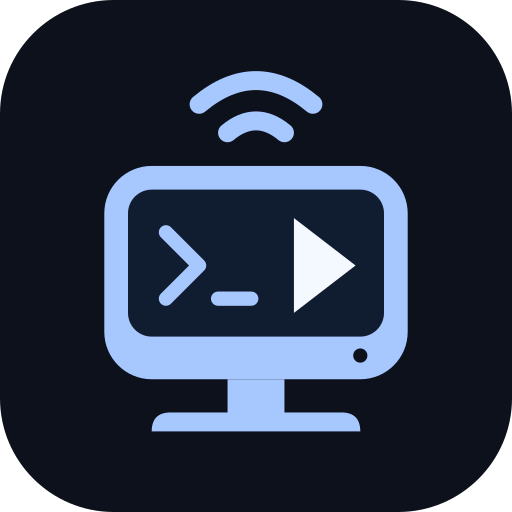

<h1 align="center">LinuxPlay</h1>

在Linux桌面上使用iPhone的CarPlay，延续WinPlay的界面与功能。

  
  
  
  
  
  

<a href="#快速入门">快速入门</a> · <a href="#主要功能">主要功能</a> · <a href="#显示与声音">显示与声音</a> · <a href="#认证与本机数据">认证与数据</a> · <a href="#其他平台">其他平台</a> · <a href="#从源码构建">源码构建</a> · <a href="docs/RELEASE-1.0.0.md">1.0.0版本说明</a> · <a href="#来源与许可">来源与许可</a>

其他平台：<a href="https://github.com/Roylyl/WinPlay">Windows</a> · <a href="https://github.com/Roylyl/MacPlay">macOS</a> · <a href="https://github.com/Roylyl/AndroidPlay">Android</a>

LinuxPlay从[WinPlay](https://github.com/Roylyl/WinPlay)迁移，参考[MacPlay](https://github.com/Roylyl/MacPlay)的跨平台接收原理，适合Linux笔记本、平板与桌面电脑。用独立CarPlay窗口操作导航、播放音乐和使用CarPlay应用，设置界面独立于接收画面。

连接、显示、音频、关于四页沿用WinPlay的布局、交互与语言资源，采用简约Linux图标，界面、托盘、接收端名称和桌面入口统一使用LinuxPlay。

蓝牙负责配对与连接引导，Wi-Fi传输音视频。支持本机热点与现有局域网两种无线模式，配置分别保存；不提供USB直连。

## 快速入门

### 使用条件

- 具备X11或XWayland图形桌面的Linux，使用BlueZ管理蓝牙、NetworkManager管理网络。显示模式的适用条件见[显示与声音](#显示与声音)。
- Python3提供Linux蓝牙socket支持，蓝牙适配器可用，BlueZ服务已启动。
- 支持CarPlay的iPhone，开启Wi-Fi与蓝牙，并允许CarPlay连接。
- 可用的本机Wi-Fi热点，或允许电脑与iPhone互访的共用局域网。电脑可通过以太网接入路由器。
- 可用的桌面音频服务、用户会话D-Bus和桌面密钥环。系统媒体控件通过MPRIS提供。

安装包内置Electron和独立Node运行时，无需另外安装Node.js。Python3、BlueZ、NetworkManager和桌面服务由Linux发行版提供。

### 安装

先按[源码构建](#从源码构建)生成安装包，或使用构建者提供的同架构AppImage/deb。64位Intel/AMD电脑使用`x86_64.AppImage`或`amd64.deb`，64位ARM设备使用`arm64`包。

Debian/Ubuntu及其衍生系统可安装deb，由包管理器处理系统依赖：

~~~sh
sudo apt install "$(xdg-user-dir DESKTOP)/LinuxPlay-1.0.0-amd64.deb"
~~~

AppImage可放在普通用户目录并直接运行：

~~~sh
chmod +x "$(xdg-user-dir DESKTOP)/LinuxPlay-1.0.0-x86_64.AppImage"
"$(xdg-user-dir DESKTOP)/LinuxPlay-1.0.0-x86_64.AppImage"
~~~

AppImage依赖系统FUSE支持。系统未提供FUSE时，可用`--appimage-extract-and-run`启动；Python3、BlueZ、NetworkManager和`xrandr`仍需由系统安装。请以普通桌面用户运行程序。

首次默认1280×720、60fps、可等比例缩放的独立画面窗口、系统默认输入/输出设备、100%音量与跟随系统语言。源码与安装包均包含配套认证文件，首次启动无需手动导入；关于页保留更换认证文件的入口，本机导入的文件优先使用。

### 无线连接

1. 在Linux系统蓝牙设置中配对iPhone，回到应用点击“刷新iPhone列表”并选择目标。
2. 选择“本机移动热点”或“现有局域网”，按下表准备网络。
3. 网络接口保持“自动选择（推荐）”，点击“读取当前网络和密码”；读取失败的部分可手动填写。
4. 点击“启动接收”，在iPhone上确认允许CarPlay。收到视频并完成首帧解码后，独立画面窗口自动显示。
5. 修改连接、显示或音频设备后，点击“应用并重新连接”。

| 无线模式 | 网络准备 | 参数来源 |
| --- | --- | --- |
| 本机移动热点 | 在系统网络设置中开启由NetworkManager管理的Wi-Fi热点，让iPhone加入 | 优先读取活动热点的名称、共享密码、信道与接口；热点关闭时可读取已保存配置 |
| 现有局域网 | 电脑和iPhone接入同一路由器；电脑可使用Wi-Fi或以太网 | 电脑使用Wi-Fi时读取对应活动连接，使用以太网时手动填写iPhone所在Wi-Fi的信息 |

热点由系统管理，停止接收不会关闭热点。网络接口可保持自动选择，也可展开“手动选择网卡（高级）”指定接口；读取网络和密码不会擅自固定网卡。“重新检测”只刷新网卡状态，点击“读取当前网络和密码”才回填，启动接收时会再次核对当前网络参数。

热点模式读取热点自身的配置，局域网模式读取所选Wi-Fi连接。整体读取失败时显示原因并保留原输入；读取到新名称但未能读取密码时，会清空旧网络密码，避免混用。名称未变且密码读取失败时，保留原密码。

读取已保存密码需要NetworkManager允许当前用户查看对应连接的密钥；系统可能要求授权。无法读取时，可手动填写。Wi-Fi共享密码需为8—63位，企业802.1X、网页登录与访客网络的客户端隔离可能阻止连接。防火墙须允许LinuxPlay与iPhone之间的TCP/UDP通信及Bonjour多播，路由器不能启用阻止两端互访的客户端隔离。

## 主要功能

| 功能 | 使用体验 |
| --- | --- |
| 无线双模式 | 本机热点与现有局域网分别保存配置，按所选模式自动检测接口 |
| 画面与多屏 | 默认1280×720、60fps，支持显示器选择、自定义分辨率、严格物理像素与全屏窗口化 |
| 鼠标与触控板 | 点击、拖动，以及上下/左右连续滚动 |
| 音量与设备 | 媒体/通话音量实时调节，输入/输出设备默认跟随系统 |
| 系统媒体控件 | 通过MPRIS同步歌曲、封面与进度，回传播放/暂停、切歌和允许的进度跳转 |
| 歌词与封面 | 标题字段中的歌词照常同步，封面独立去重并按需更新 |
| 被动断线重连 | 可选回连上次的iPhone，默认关闭，主动停止时不重连 |
| 窗口与托盘 | 正常最小化到任务栏，可选择关闭主窗口后留在托盘继续接收 |
| 多语言与外观 | 跟随系统、简体中文、繁體中文、English，以及浅色/深色外观 |
| 关于与更新 | 查看版本、检查正式发行版、打开下载入口、导出日志及管理认证 |

主窗口保留连接、显示、音频、关于四页与分组卡片。接收控制栏提供“启动接收”“停止接收”“显示画面”和“应用并重新连接”；切换设置页、语言或外观不会断开会话。CarPlay自身语言与外观仍由iPhone决定。

## 显示与声音

“显示→视频分辨率”提供屏幕原生像素、1280×720、1920×1080、2560×1440和自定义。普通窗口可以等比例调整尺寸；“严格按屏幕物理像素显示”开启后固定画面尺寸，仍可移动窗口。该选项需要成功读取所选显示器的真实像素尺寸；读取中或读取失败时，严格显示和屏幕原生像素均不可选。刷新成功后可重新开启，普通适配模式仍可使用。

帧率可选30/60/90/120fps，默认60fps。120fps启动失败后依次尝试90fps和60fps，90fps失败后尝试60fps；实际输出取决于iPhone、网络、显示器与解码能力，可在“显示→流畅度→接收统计”查看。

程序通过X11/XWayland管理窗口。X11会话使用`xrandr`读取当前活动显示模式；GNOME/Wayland会话使用Mutter显示服务读取真实分辨率与系统缩放，避免将XWayland虚拟画布当作屏幕像素。其他Wayland桌面目前使用普通适配模式。

X11缩放变换、显示服务不可用或尺寸映射不一致时，应用会禁用严格显示与屏幕原生像素。分数缩放下，画面最终由桌面合成器处理，清晰度受其缩放方式影响。

媒体音量、通话音量和播放开关实时生效。输入与输出设备默认跟随系统，也可分别选择。麦克风用于通话与语音；桌面权限拒绝后仍可接收画面与播放声音。音乐按协商延迟缓冲并按手机原始采样时间播放，导航和通话使用较短缓冲。

系统媒体控件通过用户会话D-Bus上的MPRIS接口提供。桌面支持时可显示标题、歌手、专辑、封面、播放状态、时长和进度，并回传播放/暂停、上一首、下一首及进度跳转。播放器需上报相应字段和跳转能力，直播可能不提供时长。

部分音乐App通过歌名字段显示歌词，应用会照常同步。歌词变化不会触发重复封面更新；切歌后的首张封面立即显示，同曲连续变化的封面最多每5秒更新一次。

## 窗口、更新与日志

在“连接→应用→关闭主窗口时”选择每次询问、留在托盘或退出。托盘入口可打开主窗口、显示CarPlay、启动/停止接收或退出；托盘显示取决于桌面环境是否提供相应支持。

“关于→软件更新”提供自动检查、手动检查、发行说明与下载入口。自动检查默认开启，启动后检查一次，运行期间每两小时在后台检查。Linux版本读取LinuxPlay正式发行版，按当前架构选择AppImage/deb附件，经浏览器下载后由用户安装；没有匹配附件时打开发行说明。

“关于→日志”可打开或导出诊断记录，“最近日志”支持选择与复制。保存和导出时过滤网络标识、个人路径、认证内容与配对密钥，不导出设置或认证文件。反馈问题时请说明版本、桌面环境、无线模式、现象和出现时间，音频问题再补充输出设备及连接方式。

## 认证与本机数据

源码与安装包均包含配套的`identity.pk8`与`certificate.p7b`，源码运行和安装包首次启动都无需手动导入。如需更换，可在关于页同时导入有权使用的配套文件，本机导入的文件优先使用。文件格式与公钥需匹配，最终认证由iPhone决定，普通Apple开发者签名证书不能替代CarPlay配件认证。

配套认证文件随源码保存在`resources/authentication`，构建时自动检查文件格式与密钥匹配，并嵌入安装包，无需另外寻找或复制。若文件被删除或替换后不匹配，构建会停止。认证材料与程序代码分别适用各自权利条件，详见[NOTICE](NOTICE)。

设置、本机导入的认证文件和CarPlay配对身份保存在`$XDG_CONFIG_HOME/LinuxPlay/data`，未设置`XDG_CONFIG_HOME`时使用`~/.config/LinuxPlay/data`。敏感资料加密保存在本机，使用前请解锁桌面密钥环。更换程序包保留同一用户的数据目录；请勿公开该目录、Wi-Fi密码或自行导入的认证私钥。

## 常见问题

| 现象 | 处理方法 |
| --- | --- |
| 蓝牙列表没有iPhone | 打开系统蓝牙，完成配对并刷新；确认BlueZ服务运行且适配器未被飞行模式禁用 |
| 热点模式找不到可用接口 | 在系统网络设置中开启热点，等待分配地址后刷新；热点需由NetworkManager管理 |
| 读不到Wi-Fi密码 | 授权NetworkManager读取该连接的密钥，或手动填写对应Wi-Fi的名称、密码和实际信道 |
| 蓝牙认证通过后一直等待网络 | 让iPhone加入所填Wi-Fi，核对网卡、实际信道、防火墙与路由器客户端隔离 |
| 启动后没有画面窗口 | 首帧解码后才打开窗口；查看连接状态并核对认证与网络参数 |
| 严格像素显示不可用 | X11检查`xrandr`与当前显示模式；GNOME/Wayland检查桌面显示服务并刷新。其他Wayland桌面或尺寸无法确认时使用普通适配模式 |
| 系统媒体信息为空或不能拖动进度 | 确认运行在用户桌面D-Bus会话中；音乐App需提供相应信息、时长和跳转能力 |
| 托盘看不到图标 | 检查当前桌面的托盘支持；可通过任务栏重新打开窗口 |
| 音频断续、变速或爆音 | 核对输出设备并应用重连，持续发生时导出日志并补充设备信息 |

源码目录中可运行`npm run check:system`，查看Python蓝牙socket、BlueZ、NetworkManager和桌面会话条件。

## 从源码构建

需要Linux图形桌面、Node.js24与npm。Debian/Ubuntu可先安装系统组件：

~~~sh
sudo apt install python3 bluez network-manager libsecret-1-0 x11-xserver-utils
~~~

克隆仓库或下载源码ZIP后，以下配套认证文件已包含在源码中，无需另行准备：

~~~text
resources/authentication/identity.pk8
resources/authentication/certificate.p7b
~~~

在项目根目录执行：

~~~sh
npm ci
npm run check:system
npm run build
npm start
~~~

构建时复用本机的独立Node.js24并内置到安装包，无需单独下载Node运行时。构建机、当前Node和目标安装包必须使用相同Linux架构；需要ARM64包时，请在ARM64Linux上使用ARM64Node.js24构建。

生成AppImage与deb：

~~~sh
npm run dist
~~~

打包完成后，安装包和`LinuxPlay-1.0.0-更新说明.md`会自动导出到系统桌面，`dist`保留构建副本。64位Intel/AMD安装包为`LinuxPlay-1.0.0-x86_64.AppImage`与`LinuxPlay-1.0.0-amd64.deb`；ARM64安装包文件名使用`arm64`。

已有安装包时，可执行`npm run export:release`重新导出，无需再次打包。每次发布先维护对应的`docs/RELEASE-<版本号>.md`，桌面更新说明会使用该版本内容，文件名随版本号更新。

| 目录 | 内容 |
| --- | --- |
| `src/engine` | 无线引导、CarPlay协议、配对与音视频接收 |
| `src/ui` | 沿用WinPlay的设置界面、画面、音频与多语言资源 |
| `src` | Electron主进程、Linux网络、显示与MPRIS适配 |
| `native/linux-platform.py` | Linux蓝牙设备与RFCOMM数据桥接 |
| `resources` | LinuxPlay图标与构建所需认证材料 |
| `scripts` | Linux构建、系统依赖诊断和打包 |

上述两份内置认证文件随源码分发；其他本机认证文件、个人配置、依赖缓存和构建产物由`.gitignore`排除。

## 其他平台

如果需要在其他设备上使用CarPlay，可以选择对应平台的项目。

| 项目 | 适用平台 | 连接方式 |
| --- | --- | --- |
| [WinPlay](https://github.com/Roylyl/WinPlay) | Windows10/11x64 | 本机移动热点或现有局域网无线连接 |
| [MacPlay](https://github.com/Roylyl/MacPlay) | macOS14及以上 | USB直连或共用局域网无线连接 |
| [AndroidPlay](https://github.com/Roylyl/AndroidPlay) | Android9及以上 | 系统热点与蓝牙无线连接 |

## 来源与许可

LinuxPlay基于[WinPlay](https://github.com/Roylyl/WinPlay)，复用其前端与CarPlay接收流程；无线引导参考[AndroidPlay](https://github.com/Roylyl/AndroidPlay)，协议与跨平台原理参考[MacPlay](https://github.com/Roylyl/MacPlay)。保留[LIVI](https://github.com/f-io/LIVI)、LasseHeitgres及贡献者和[DiPlay](https://github.com/shihabal3amri/DiPlay)来源声明。

项目沿用GPL-3.0-or-later，见[LICENSE](LICENSE)、[NOTICE](NOTICE)与[第三方声明](vendor/THIRD-PARTY-NOTICES.txt)。LinuxPlay是独立衍生项目，不代表Apple或上游作者，不声称获得MFi认证。第三方组件、认证证书、私钥和商标继续适用各自权利条件；分发修改版时应保留声明并提供适用许可证要求的对应源码与构建资料。
